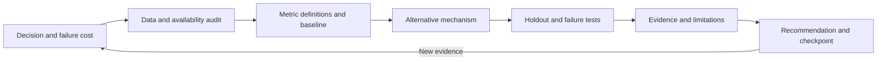

# Start with the decision, then earn the conclusion

My approach begins before model selection. I want to know who will use the result, what action it changes, and what a wrong answer costs. That determines which evidence and metrics deserve attention.

## 1. Frame the topic and narrow the problem

"Build a recommender" is a topic. "Retrieve a user's later positive ratings from a catalog using only earlier interactions" is a testable problem. I state the population, time window, candidate set and baseline before comparing algorithms.

## 2. Audit what is actually available

I separate direct observations, assumptions and interpretations. A rating is not an impression. A delayed outcome is not a feature available at the time of a decision. A document matching a query is not necessarily approved, current or visible to the person asking.

The data card should resolve those distinctions before the headline result does.

## 3. Give the ordinary approach a fair test

A simple baseline answers whether complexity is useful. It needs the same population, candidate set and metric definitions as the alternative. I do not deliberately weaken its input or evaluate it against a different task.

## 4. Change one mechanism that addresses the failure

For retrieval, that mechanism is an evidence contract. For risk, it is a point-in-time replay and label-maturity rule. For ranking, it is learning from past interactions while preserving a chronological evaluation boundary.

The framework is useful only if a reviewer can see which mechanism changed and test it separately.

## 5. Try to invalidate the first conclusion

I test boundaries, not only typical examples: another tenant's query, an event replayed twice, an unavailable label, an unseen item, or an ambiguous policy request. Aggregate accuracy cannot substitute for those checks.

## 6. Communicate what the result changes

The report should answer: what happened, how large it was, which comparison supports it, what it does not establish, and what should happen next. A larger model winning is one possible outcome. A simple baseline remaining preferable is another.

The structure reflects my supplied decision-analysis and research-audit prompt examples. Those private prompt files are not published in this repository.
