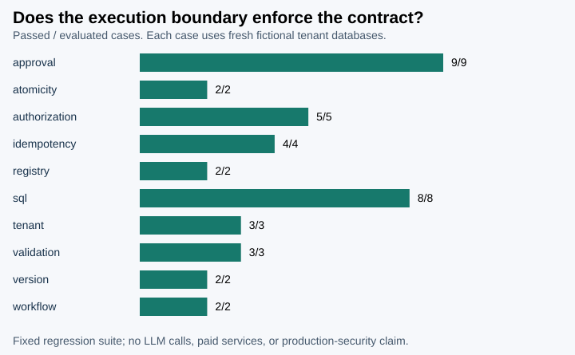

# Approval Workflow Lab: the permission belongs to the transaction

The execution boundary passed **40/40 fixed evaluation contracts**. The separate development suite passed 8/8. This is evidence for a small implemented protocol, not a model accuracy score, penetration test, or record of a customer deployment.

## The question I chose

When a support assistant suggests a plan change, what exactly did the reviewer approve? I narrowed that question to two fictional SaaS actions: change an account plan and change a support case status. A useful answer has to survive retries, a different tenant, a changed payload, and a stale record version.

## The usual shortcut and its failure mode

A tool returning `approved: true` does not bind permission to the action that will eventually run. The account, operator, payload, or version can change between review and execution. I implemented the authorization check at the database mutation boundary, where the current record version and the signed approval can be checked together.

## My framework

1. Start with a trusted application principal and a fixed tenant database registry.
2. Register narrow tools and snapshot each change payload before validation. Use that detached value for every digest, retry fingerprint, stored request and mutation; treat instructions and SQL strings as untrusted inputs.
3. Persist a change request and show its exact operation, payload digest, version, and expiry to a different reviewer.
4. Sign that transaction's claims; re-check every binding when execution begins.
5. Commit the mutation, idempotent receipt, and execution audit event in one SQLite transaction.
6. Evaluate state and audit outcomes as well as return codes.

The contract router accepts exact typed intents. It does not interpret natural language and it makes no LLM calls. I used synthetic approval and injection attempts to test the enforcement boundary, without scoring an imaginary agent.

## What the run actually showed

| Evaluation category | Passed | Cases |
| --- | ---: | ---: |
| approval | 9 | 9 |
| atomicity | 2 | 2 |
| authorization | 5 | 5 |
| idempotency | 4 | 4 |
| registry | 2 | 2 |
| sql | 8 | 8 |
| tenant | 3 | 3 |
| validation | 3 | 3 |
| version | 2 | 2 |
| workflow | 2 | 2 |

- Expected rejection cases: 29. A pass requires the expected error and the expected database state.
- Committed resource mutations across fresh evaluation sandboxes: 6; matching execution audit events: 6.
- Concurrent replay case: 8 calls, 1 newly applied mutation, 7 cached receipts. Duplicate calls receive the same result; they do not apply another mutation.
- The failure-injection case raised after the SQL update. The resource version stayed at zero, the request stayed approved, and no execution receipt or execution audit event survived.
- Separate writer-lock regression tests mutate caller-owned payload dictionaries after preflight. Both request persistence and execution retain their original snapshots, so a later caller mutation cannot substitute an unapproved action while the transaction waits.
- Ratio KPIs retain their denominator. An empty denominator produces `null` and `not_applicable`, not an invented zero percent.

## What I would challenge before rollout

Passing these cases does not establish resistance to every SQL or authorization attack. Principals are trusted inputs here; a production service needs verified identity, tenant membership, role provisioning, key storage/rotation, rate limits, independent review, and operational incident logging. The audit database is durable local evidence, not administrator-proof storage. SQL budget units are SQLite virtual-machine instructions, not wall-clock or memory isolation.

The evaluation fixture is a frozen, authored contract set separated from eight development examples. Its expected outcomes are visible in the repository. It is not an independently collected or statistically held-out user distribution. I would next run customer-approved workflow examples in shadow mode, review every proposed change with an operator, and record disagreements before enabling any real mutation.

## Reproduce and inspect

Run `python -m approval_workflow benchmark --output results` from the project folder, then `python -m unittest discover -s tests -v`. The signing key is generated in memory; each case creates and removes fresh local SQLite fixtures.

- [Executed case records](cases.jsonl)
- [Machine-readable metrics](metrics.json)
- [Original scenario fixture](../data/scenarios.json)
- [Data card](../data/DATA_CARD.md)
- [Architecture and trust boundaries](../docs/architecture.md)

Fixture SHA-256: `10bf35e1459e7fa19fc00c1da243bae382967a523557b381acddbdcb38f3886d`.
