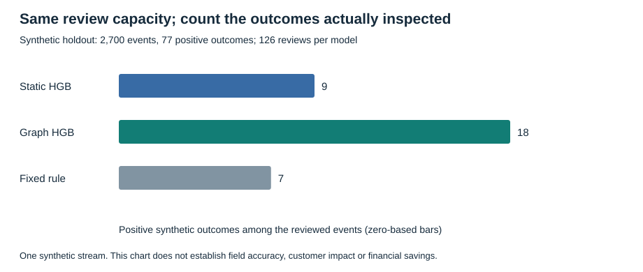
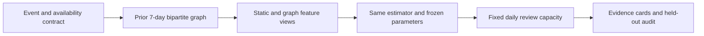

# Graph Risk Investigations

**Would shared-device context change the review queue, or merely make it more complicated?**

I built this independent reference experiment to make that question inspectable. A transaction-only model can miss coordination between accounts. A full-dataset graph can appear to solve the problem while leaking connections from the future. The useful design question is which relationships were actually observable when the event was scored.

This project adds prior customer-device graph features to an otherwise identical boosted-tree estimator. It includes benign shared-device confounders, unseen entity cohorts, delayed labels, a declared mechanism shift, a fixed daily review budget and analyst evidence cards.

This is new portfolio work created in November 2026, with original synthetic data. It is separate from CSAA or client systems and does not validate past workplace performance or adoption figures. It implements graph features, not a graph neural network.

## Read the story and inspect the evidence

- [Executed case study](reports/case-study.md): topic, ordinary workflow, failure mode, design, measured outcome, tradeoff and next decision.
- [Numerical source of truth](reports/metrics.json) and [every held-out prediction](reports/predictions.csv).
- [Analyst evidence cards](reports/investigation-cards.json), which intentionally omit outcome labels.
- [Original packaged dataset](reports/data/transactions.csv.gz), [manifest](reports/data/manifest.json) and [data card](DATA_CARD.md).



## Run the complete experiment

Python 3.11 is the tested runtime. The CLI defaults OpenMP, OpenBLAS and MKL to one process-local thread before numerical imports, while respecting explicit caller overrides.

```bash
python -m venv .venv
# Windows: .venv\Scripts\activate
# macOS/Linux: source .venv/bin/activate
python -m pip install -r requirements.txt
python -m unittest discover -s tests -v
python -m graph_risk demo --out reports
```

No API key, external dataset, model download or GPU is needed. To keep a fresh experiment separate from the committed run:

```bash
python -m graph_risk demo --out runs/seed-42 --seed 42
python -m graph_risk report --out runs/seed-42
```

The seed is an input, not a target to search for a flattering result. The committed protocol fixes the estimator parameters before the experiment and keeps the comparison and its uncertainty visible.

## The framework



| Boundary | Implementation |
|---|---|
| Event availability | Features use `[t-7days, t)`; same-time peers are excluded |
| Label availability | Fit and audit cutoffs are separate from event dates |
| Identity leakage | Customer and device IDs are disjoint across train, validation and test; IDs are not model inputs |
| Comparison | Same HGB parameters; the additional graph feature view is the changed mechanism |
| Review capacity | `floor(0.05 * events_per_day)`, deterministic ties by event ID |
| Human oversight | Evidence cards describe observed links; no automatic account action or fraud accusation |
| Reproducibility | Original generator, exact packaged data, source/data hashes, row-level scores and generated narrative |

The existing [Point-in-time Risk](../point-in-time-risk/) project explores replay, checkpoints and late-event handling. This project focuses on graph context and investigation. It assumes in-order event availability and does not claim distributed serving scale or production latency.

## Sources and rights

Primary conceptual references: [time-respecting graph features](https://arxiv.org/abs/2603.06632), [temporal-shift evaluation critique](https://arxiv.org/abs/2604.19514), [HGB API](https://scikit-learn.org/1.3/modules/generated/sklearn.ensemble.HistGradientBoostingClassifier.html) and [average precision](https://scikit-learn.org/1.3/modules/generated/sklearn.metrics.average_precision_score.html). Their datasets, code and result numbers were not copied into this experiment.

The original code and synthetic data are covered by the [MIT license](LICENSE). The implementation follows the build-and-explain direction of [Build Your Own X](https://github.com/codecrafters-io/build-your-own-x).
