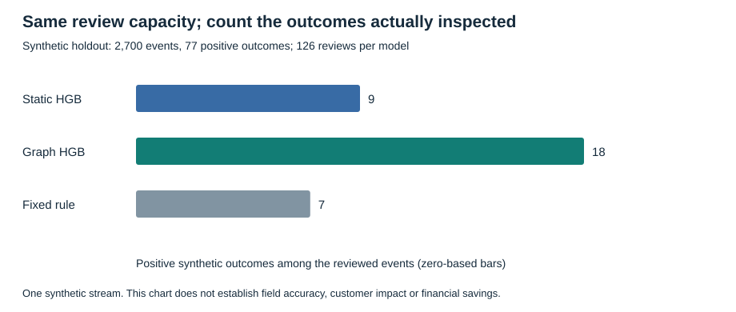
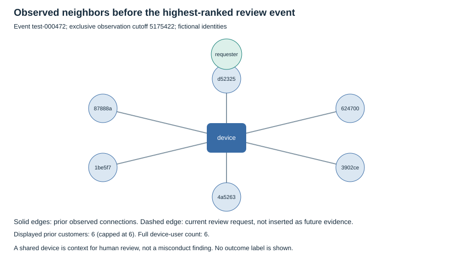

# Shared devices need context before they become a review decision

**Decision: Treat the graph candidate as worth a representative offline pilot, not deployment approval.**

This is a new independent portfolio experiment by Vedant Thaker, created in November 2026. It uses original fictional events. It does not reproduce CSAA systems, validate historical employer metrics, or establish real fraud effectiveness.

## Start with the topic: identity relationships in fraud investigation

The narrow question is whether prior customer-device connections add useful ranking information when analysts can inspect only 5% of each day's events. A shared device is an observation; it is not a fraud label. Families and public terminals can create legitimate shared connections too.

## The usual approach hides two different issues

A transaction-only model can consider amount, country changes, channel and time of day while missing coordinated reuse of infrastructure. The tempting alternative is a graph built from the entire dataset. That graph may contain connections that did not exist at the decision time.

I separated those issues. Both trained comparators use the **same histogram gradient-boosting estimator and fixed parameters**. The graph candidate receives additional time-respecting structural features. Neither receives customer IDs, device IDs, ring membership, outcome labels, future edges or label-derived neighbor statistics as features.

## My framework: observe, connect, rank, explain

1. **Observe:** define one row as one fictional transaction and record when its label becomes available.
2. **Connect:** build the bipartite customer-device context from `[t-7days, t)`. All events at a tied timestamp are scored before any of their edges enter the graph.
3. **Rank:** compare a fixed rule, static-feature HGB and the same HGB with graph features at exactly the same daily capacity.
4. **Explain:** provide a review card containing observed connections and the decision-time window, without inserting the eventual outcome or calling an account fraudulent.

The train, validation and test cohorts are separated in time **and** customer/device identity. The final model is refitted using only mature train and validation labels available by day 50, then frozen before the day-50-to-70 test cohort. The test audit uses labels available by day 75. The validation results are visible in the metrics; no hyperparameter or seed search follows them.

## What the executed experiment found

The full stream contains **9,000 events**. The test cohort has **2,700 events** and **77 positive synthetic outcomes**.

| Model | Average precision | Positive outcomes / reviewed | Precision at capacity | Recall at capacity |
|---|---:|---:|---:|---:|
| static_hgb | 0.0429 | 9/126 | 0.0714 | 0.1169 |
| graph_hgb | 0.1096 | 18/126 | 0.1429 | 0.2338 |
| simple_rule | 0.0368 | 7/126 | 0.0556 | 0.0909 |

The graph-minus-static AP difference has a descriptive 95% day-block bootstrap interval of **[0.0304, 0.1099]** over fixed test predictions. It does not fully capture cross-day customer/ring dependence or estimate variation across synthetic generators, training seeds or future customer populations.

## Where the result changes under a different mechanism

The generator deliberately changes coordinated-device reuse and label risk from day 60 onward. This is a declared synthetic shift, not evidence that a real adversary behaved this way.

| Test segment | Static positive reviews | Graph positive reviews | Reviews per model | Positive outcomes |
|---|---:|---:|---:|---:|
| original | 5 | 13 | 64 | 43 |
| shifted | 4 | 5 | 62 | 34 |

The additional reviewed positives are concentrated before the declared shift: +8 in the original segment versus +1 after the change. I would not treat the full-period gain as evidence of stable performance under a changed mechanism.

## What impact means here

The practical quantity is the number of additional positive synthetic outcomes inspected at an unchanged review capacity: **+9** in this run. It is neither a customer-loss estimate nor a production capture lift. The synthetic mechanism was designed to include coordinated reuse, so the result establishes that this implementation can inspect that constructed signal, not that graph features will generalize to field data.

The analyst cards make the context inspectable. They expose a shared-device count, prior links and observation window. They are evidence summaries, not causal feature attributions or calibrated fraud probabilities. The implementation never blocks payments or changes account state.

## The tradeoff I would take into the next review

The static model is cheaper to reason about and does not need a graph state. The candidate adds state correctness, identity quality, retention and late-data requirements. This offline replay assumes each event is available at its timestamp; it does not solve out-of-order arrival. A production system would need an arrival-time contract, late-event handling and representative labels before its outcomes could be interpreted.

My next checkpoint would use an independently sourced, authorized dataset; observed label delays; benign shared-infrastructure slices; multiple predeclared seeds and time windows; and measured end-to-end state latency. I would keep the review budget fixed and reject the candidate if the extra state fails to improve the relevant queue reliably.

## Reproduce and challenge the conclusion

The numerical source is [metrics.json](metrics.json); [predictions.csv](predictions.csv) includes every held-out score and queue assignment. [investigation-cards.json](investigation-cards.json) contains the ten highest-ranked review cards without outcome fields. The packaged [synthetic events](data/transactions.csv.gz) and [data manifest](data/manifest.json) belong to this exact run. The [project data card](../DATA_CARD.md) explains the mechanism and scope.

The graph-feature design is informed by primary work on time-respecting graph evaluation, including [Khaleghpour and McKinney, 2026](https://arxiv.org/abs/2603.06632) and [Maganti, 2026](https://arxiv.org/abs/2604.19514). Those papers' code, datasets and benchmark numbers are not copied or used as this project's evidence. This project implements structural features and boosted trees, not a graph neural network.
