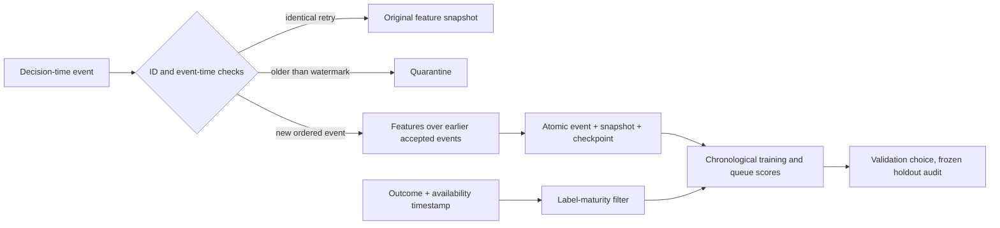
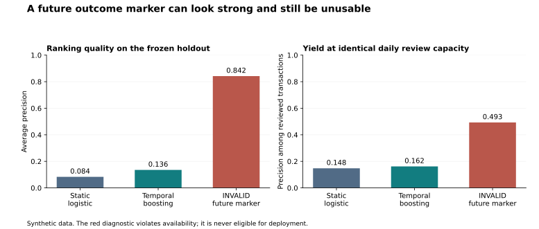
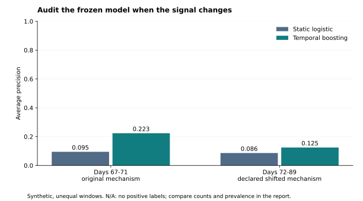

# I checked the clock before trusting the fraud score

**Project:** Point-in-time Risk  |  **Author:** Vedant Thaker  |  **Status:** independent portfolio reference implementation

This is newly built public portfolio work. All transactions and outcomes are fictional, generated by the included code. It is not a reconstruction of an employer or client system, and its measured scores are not workplace results.

## The topic: a decision is only as valid as the evidence available at that moment

The narrow problem is fraud-review prioritization under a limited daily review budget. A transaction arrives, a feature vector is recorded, and the system later learns its outcome. That order matters. A convincing offline score can describe an investigation that has already finished rather than a decision the system could have made.

I started with a decision contract: can event-time behavior improve a fixed-capacity review queue over a model that sees only the transaction itself? The model comparison matters, but so do two prior questions: was the feature available, and had the training label matured?

## The usual shortcut and the issue I wanted to expose

A common implementation pattern is to join a transaction table to a current customer aggregate, train a classifier, and report one score. The risk is in the word *current*: aggregates can include later transactions, and a dispute or chargeback indicator may arrive days after the transaction. A random split cannot repair that availability problem.

I implemented three paths on the same chronological holdout: a static logistic baseline; a temporal-feature gradient-boosting candidate; and a deliberately invalid diagnostic that adds a later investigation marker. The last path is an executable warning. It is never a deployment candidate or a model-selection input.

## My framework: event, availability, capacity, evidence

1. **Record the event before the outcome.** The serving event type contains no label or investigation marker. SQLite stores each accepted event, its pre-event feature snapshot, and the watermark in one transaction.
2. **Make time boundaries explicit.** Historical windows are left-inclusive and right-exclusive: `[t-window, t)`. All events with the same timestamp are excluded from each other's features. A customer-device novelty feature uses only earlier accepted events.
3. **Give retries and late data different treatment.** Repeating an ID with identical content returns the original snapshot. Conflicting content raises an error. A new event older than the watermark enters quarantine and cannot silently rewrite historical decisions.
4. **Wait for labels.** Selection training freezes at day 45. Validation transactions occupy days 45-59 and are evaluated as of day 67. The final models use events before day 60 with labels available by day 67. The test begins at day 67, after the validation labels can exist.
5. **Compare at the same review capacity.** For each test day, both models receive `floor(0.05 × transactions that day)` review slots. This is an offline daily-queue ranking experiment, not a calibrated live blocking threshold.
6. **Keep the test out of tuning.** Only validation average precision selects 7 versus 15 leaves. The holdout is then an audit of the frozen choice. The generator, seeds and full per-transaction predictions are included.

## What the executed experiment establishes

The generator produced **12,000 transactions** across 90 synthetic days. The holdout contains **3,045 transactions**, including **78 positive labels** (2.6% prevalence). These denominators apply to every model below.

| Frozen model | Average precision | Reviews | True positives reviewed | Precision at daily budget | Recall at daily budget |
|---|---:|---:|---:|---:|---:|
| Static logistic baseline | 0.0835 | 142 | 21 | 14.8% | 26.9% |
| Static boosting: exploratory feature ablation | 0.1120 | 142 | 19 | 13.4% | 24.4% |
| Temporal boosting | 0.1356 | 142 | 23 | 16.2% | 29.5% |
| INVALID future-marker diagnostic | 0.8421 | 142 | 70 | 49.3% | 89.7% |

**Finding 1 — the queue comparison uses the same denominator.** The temporal model placed 2 more synthetic positive outcomes in the review queue, using the same **142 reviews**. Rounding daily capacities down makes the actual review fraction **4.7%**, below the nominal 5%. This demonstrates queue behavior under the generator's assumptions; it does not establish fraud prevented or money saved.

I also checked the alternative explanation that the model class, rather than temporal features, explains the difference. An exploratory static-feature boosting ablation keeps the candidate's selected algorithm configuration and reaches AP **0.1120**, with **19** positives reviewed. This post-hoc diagnostic changes neither the candidate nor its hyperparameters; it is not a new selection trial. The primary logistic-versus-temporal comparison changes both features and algorithm, so it cannot by itself attribute an effect to feature engineering.

**Finding 2 — availability changes which data can train the model.** The day-45 maturity rule excludes **623 recent transactions** whose outcomes are not yet available. There are **5,402** selection-training rows, **2,016** validation rows and **8,041** final-training rows. The chosen candidate has **7 leaves**, selected from validation only.

**Finding 3 — a better-looking score can be an invalid result.** Adding the future investigation marker produces average precision **0.8421**. Its timestamp is later than the decision, so this score is disqualified regardless of how it compares with the valid models. The safe serving feature contract does not expose that column.

## I checked whether the result survives a changed mechanism

The synthetic generator weakens the shared-device signal and strengthens the country-change signal beginning on day 72. This is a declared, designed shift, not a discovered real-world fraud pattern. The holdout is split at that boundary below; short windows and different label prevalences limit comparability.

| Holdout segment | Transactions | Positives | Baseline AP | Temporal AP | Baseline recall | Temporal recall |
|---|---:|---:|---:|---:|---:|---:|
| original | 672 | 18 | 0.0947 | 0.2234 | 27.8% | 38.9% |
| shifted | 2,373 | 60 | 0.0862 | 0.1245 | 26.7% | 26.7% |

N/A means the metric has no denominator: average precision and recall are undefined in a segment with no positive labels; review precision is undefined when no review slots are allocated. An omitted AP bar is not a zero score.

A paired day-block bootstrap with **200 draws** gives a descriptive 95% percentile interval of **[-0.0071, 0.1328]** for temporal minus static average precision. It resamples the same **23 holdout days** using fixed fitted models. It omits model-fitting uncertainty and cannot establish generalization beyond this synthetic mechanism; dependence across days may remain.

The interval and segment-level queue yields are checks on the initial story, not footnotes to hide. If the interval includes zero, or the shifted queue loses its advantage, the evidence does not justify calling the improvement robust.

## The system tradeoff is visible too

The replay accepted **12,000 unique events**, absorbed **24 exact retries**, and quarantined **3 deliberately late demonstration events**. The local replay took **39.887 seconds** (300.9 accepted events/second on this run). This includes SQLite commits and feature queries on one machine; it is not a distributed throughput or serving-latency claim.

Quarantine makes history stable and failure behavior inspectable. It also discards late evidence from subsequent feature calculations. A deployment with significant out-of-order traffic would need an allowed-lateness policy, compensating backfill and a new evaluation. This reference implementation intentionally does not claim to solve that distributed-systems problem.

## The decision I would carry forward

Keep the static baseline as the comparison reference and test the temporal candidate on additional held-out streams. This single run does not establish a robust advantage at the review budget.

The useful impact here is an inspectable decision process: a reader can see which events entered a model, when labels became usable, how a fixed capacity turns into precision and recall, and why an impressive invalid score must be rejected. No business adoption, fraud reduction, client deployment or financial benefit is claimed.

Before a real pilot I would require a representative licensed event stream, adjudication delays, observed late-arrival rates, review costs and failure modes. I would monitor queue yield, review volume, label delay, drift, quarantine volume and replay conflicts. A sustained held-out improvement at a comparable review budget would support the next experiment; failure on those checks would change the recommendation.

**Confidence:** high in the tested temporal and replay contracts; conditional evidence about model ranking inside this synthetic dataset; insufficient evidence about production impact.

## Reproduce or challenge the story

- `python -m unittest discover -s tests -v` checks the failure contracts.
- `python -m risklab demo --out artifacts` regenerates data, predictions, metrics, this report and charts.
- `python -m risklab report --out artifacts` regenerates presentation artifacts from `metrics.json` only.
- Change the generator seed or mechanism, not a hand-edited metric. Treat a new run as a new experiment.
- The [packaged baseline dataset](../data/transactions.csv.gz) contains the default seed-19 experiment. Every demo writes its own local `transactions.csv`, whose SHA256 is recorded in that run's `metrics.json`; custom seeds or event counts produce different data. `test_predictions.csv` supports row-level metric verification; the generated `replay.sqlite` contains the decision-time ledger only and is not committed.

## Conceptual references and authorship

The build-from-first-principles direction was inspired by [Build Your Own X](https://github.com/codecrafters-io/build-your-own-x), particularly its database and distributed-systems categories. The code, fictional data mechanism and evaluation design here are original implementations; no tutorial code, dataset, benchmark result or workplace artifact was copied. The project uses [Python's SQLite interface](https://docs.python.org/3/library/sqlite3.html) and [scikit-learn](https://scikit-learn.org/stable/) as dependencies.
