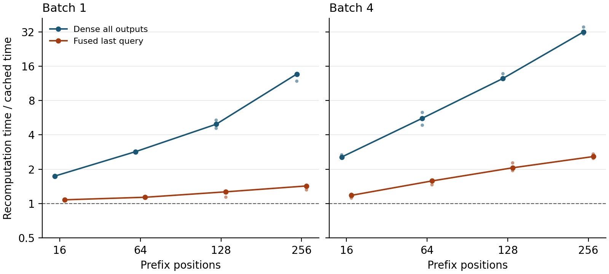

# Separating KV reuse from discarded outputs in a single-layer attention benchmark

Vedant Thaker  
Independent Researcher, Jeffersonville, Indiana, USA  
vedant.thaker1602@gmail.com

Systems measurement report · November 24, 2026

### Abstract

When a decoder benchmark requests one output at a time, its reference implementation may still compute attention for the entire prefix. In an archived 48-configuration CPU experiment, the median timing ratio of full recomputation to key–value (KV) reuse was 4.505. Computing only the requested attention output while still reprojecting the prefix reduced that ratio to 1.271. A second experiment matched the query and output projections in both programs and varied whether the program retained keys and values. For a 256-position prefix, reuse was faster in all 72 paired timing blocks on the test CPU. At batch one and a 16-position prefix, it was faster in 25 of 36 blocks. Two archived Tesla T4 runs compare only the original full-recomputation and reuse paths. The size of the apparent gain therefore depends on which discarded work the reference executes, and the available GPU timings cannot isolate the contribution of KV reuse.

## Which work does the reference repeat?

Inference Systems Lab supplies a public example in which an untrained attention layer receives a prefix followed by a fixed sequence of embeddings [1]. At every subsequent position the program returns just the newest output. The dense reference nevertheless evaluates attention for every available query and projects every output. Its competitor stores projected keys and values and evaluates only the current query. A ratio of their running times puts a price on both changes together.

The unit of measurement here is one sequence of requested outputs on one layer. Four heads share width 64. The programs use the same weights, input embeddings and causal scaled dot-product attention [2]. Fixed embeddings allow the cached program to initialize its keys and values without computing earlier prefix outputs. A trained multilayer decoder must obtain its input representations from preceding layers. The experiment also omits token generation, server queues and cache sharing between requests. Serving systems such as PagedAttention address a different allocation problem [3]. Optimized kernels such as FlashAttention change the memory traffic of the attention operation itself [4].

## Output selection in the original CPU runs

Four eager PyTorch programs ran with a single computation thread on one Windows CPU host using Python 3.11.9 and PyTorch 2.9.1+cpu. **Dense-all** applied a fused query, key and value (QKV) projection to the full growing prefix, formed the masked attention matrix and kept only the last output. **Fused last-query** retained the same full-prefix QKV projection, including earlier queries, but evaluated attention and the output projection only at the requested position. **Cached concatenation** projected the prefix once and appended each new key and value with tensor concatenation. **Cached preallocation** wrote the same projections into fixed-capacity buffers. Each cached timer included prefix projection, creation or growth of its buffers and final output assembly.

The grid crossed batch sizes 1 and 4, prefix lengths 16, 64, 128 and 256, decode lengths 8 and 32, and three input seeds. Each of the 48 configurations had three warmups per method followed by 11 blocks with one run of every method in randomized order. There were 2,112 CPU timings in one process. The numbers in the first two result columns of Table 1 use a ratio of the two method medians within each configuration. The next two columns pair observations within each block before taking their median within the configuration. The two summaries weight transient timing variation differently. A ratio over one favors the denominator.

| Timed numerator / denominator | Median of case ratios | Cases over 1 | Median of paired case ratios | Cases over 1, paired |
|---|---:|---:|---:|---:|
| Dense-all / cached concatenation | 4.505 | 48/48 | 4.485 | 48/48 |
| Fused last-query / cached concatenation | 1.271 | 44/48 | 1.298 | 44/48 |
| Cached concatenation / preallocation | 0.965 | 20/48 | 0.973 | 23/48 |

Table 1. Medians across the fixed design grid. In the last row, a ratio over one means that preallocation finished sooner.

The choice of output positions changed the comparison much more than the choice of timing summary. On the original per-case measure, dense-all/cached ratios ranged from 1.449 to 35.260. Fused last-query/cached ratios ranged from 0.786 to 2.720. Storage layout and concatenation still mattered, but the grid did not consistently favor preallocation. All recorded outputs passed the float32 checks at absolute and relative tolerance 1e−5. The largest absolute deviation from dense-all was 8.94 × 10⁻⁸. The retained first output also passed the future-input perturbation check in every configuration.

## Matching the query projection on both sides

Fused last-query still projects earlier queries that it immediately discards. A second experiment removed this difference by splitting the same QKV weight tensor into a query projection and a combined key–value projection. At each requested position **both** programs projected exactly one current query and one output. The recomputation path projected keys and values from every available embedding on every step. The reuse path projected keys and values once for the prefix and once for each new position, then appended by concatenation. Both paths used the same attention calculation and output assembly. This comparison retains the real cost of growing the cache.

For batch B, width W, prefix P and D requested positions, let nᵢ = P + i for i = 1,…,D. The number of key and value projection multiply–accumulates (MACs) saved by reuse is 2BW²[Σᵢ nᵢ − (P + D)]. The query, attention-score, value-aggregation and output matrix products have identical dimensions on both paths. This accounting excludes copying, dispatch, softmax and memory access. For the original fused programs at B = 1, W = 64, P = 128 and D = 64, the dense-all, fused last-query and cached paths require 382,119,936, 127,799,296 and 3,936,256 matrix MACs. Their arithmetic ratios alone do not predict elapsed time.

The matched experiment used float32, 32 requested positions and seed 42. Three fresh Linux processes used PyTorch 2.9.1+cpu, one intra-op and one inter-op thread, pinned to one allowed logical CPU on an AMD EPYC 9V74 host. The four configurations crossed B = 1 or 4 with P = 16 or 256. Each process randomized case order independently. After three warmups per path, each case ran 12 paired blocks, six in each execution order, shuffled before timing. A wall-clock call covered one complete sequence, including prefix setup and cache concatenation. The 288 calls are repeated timings on the same machine. Hardware clocks and other host workloads were uncontrolled.

| Batch | Prefix | Process 1 | Process 2 | Process 3 | Blocks favoring reuse |
|---:|---:|---:|---:|---:|---:|
| 1 | 16 | 1.016 | 1.211 | 1.079 | 25/36 |
| 1 | 256 | 1.770 | 1.971 | 1.932 | 36/36 |
| 4 | 16 | 1.493 | 1.412 | 1.380 | 34/36 |
| 4 | 256 | 3.142 | 3.155 | 2.849 | 36/36 |

Table 2. Median of 12 within-block recomputation/reuse ratios in each process. The final column counts individual pairs across the three processes.

With a 256-position prefix, every paired timing favored reuse, even after matching the query and output projections. At batch one and prefix 16 the first process had a median ratio of only 1.016 and the direction varied across individual blocks. This result places the strongest support at the long-prefix end of the matched grid. The original Windows experiment and the matched Linux experiment changed both host and program. Subtracting their timing ratios would not isolate the cost of the discarded query projection.

Both new paths agreed with dense-all in the timed configurations to a maximum absolute error of 8.94 × 10⁻⁸. A separate numerical check compared each path at each geometry to one float64 causal PyTorch scaled-dot-product-attention call on the entire sequence. It selected the requested suffix only after the library call. The largest error across the eight comparisons was 1.95 × 10⁻¹⁶ or less [5].

## What the T4 recordings contain

The public GPU archive records two environments [1]. The second capture followed installation of optional dependencies and a Python restart. Both used float16, B = 1, P = 128, D = 64, four heads and width 64. Each program had three warmups and seven measured runs. The runner used CUDA events and synchronization, with all dense timings collected before all cached timings [6].

| Tesla T4 capture | Dense-all median (ms) | Cached concatenation median (ms) | Ratio |
|---|---:|---:|---:|
| Torch 2.11.0+cu130 | 25.626 | 20.790 | 1.233 |
| Torch 2.13.0+cu130 after restart | 23.859 | 17.525 | 1.361 |

Table 3. Ratios of separate sample medians. Repetition numbers were collected in blocks by method and do not define randomized pairs.

The maximum float16 output difference was 6.10 × 10⁻⁵ in each capture. Both report a 10,620,928-byte allocator peak covering the combined measurement. The final logical KV payload was 49,152 bytes, from 2 × B × (P + D) × W × 2 bytes. A combined peak cannot establish per-method memory use. Installation, runtime and collection time changed together, so their effects cannot be separated. No GPU capture of the matched-query or preallocation comparisons accompanies these two records.

## Interpretation

A benchmark that returns only the last output should state how many outputs its reference computes and how many input positions it reprojects. For the supplied layer, most of the median timing contrast between the original programs disappeared when the reference stopped computing earlier attention outputs. A smaller, directly measured reuse advantage survived in the matched long-prefix CPU comparisons. To establish that narrower effect on GPU requires timing both matched paths on the same device under interleaved ordering. Real serving latency would require a workload with actual requests, generated tokens and a defined quality criterion.

## Data and code availability

The accompanying study directory contains both CPU timing records, the paired-block analysis, numerical tests and the two archived T4 captures. Run instructions and dependency versions are in `study/README.md`. Each matched-process file contains its raw timings, start and end timestamps, order, hardware description and source hashes. The public T4 source and both captures are in the [pinned project archive](https://github.com/VEDANT1602/inference-systems-lab/tree/7e1b547cb35c32e5286acc342529617a7ad3c5f4/results/colab-t4).

## Author and disclosures

Vedant Thaker is the sole author and maintains Inference Systems Lab, the underlying attention project. The original draft records assistance from OpenAI Codex with literature retrieval, audit design, implementation, execution, analysis and writing. Clever AI Humanizer suggested wording for the introduction, background and discussion of that draft. Codex also assisted with the matched-query experiment, reconstruction of the recorded timings, source checks and revision of this report.

This research received no specific grant from any funding agency in the public, commercial, or not-for-profit sectors. The author declares no competing interests.

## References

[1] V. Thaker. Inference Systems Lab. Original [standalone source snapshot](https://github.com/VEDANT1602/inference-systems-lab/tree/9123c1bc0285130de3e920b61ae18dad58107b88). Both Tesla T4 records and environment descriptions are in the [complete GPU archive](https://github.com/VEDANT1602/inference-systems-lab/tree/7e1b547cb35c32e5286acc342529617a7ad3c5f4/results/colab-t4).

[2] A. Vaswani et al. Attention Is All You Need. Advances in Neural Information Processing Systems 30 (2017). <https://proceedings.neurips.cc/paper_files/paper/2017/hash/3f5ee243547dee91fbd053c1c4a845aa-Abstract.html>

[3] W. Kwon et al. Efficient Memory Management for Large Language Model Serving with PagedAttention. Proceedings of the 29th Symposium on Operating Systems Principles, 611–626 (2023). <https://doi.org/10.1145/3600006.3613165>

[4] T. Dao, D. Y. Fu, S. Ermon, A. Rudra and C. Ré. FlashAttention: Fast and Memory-Efficient Exact Attention with IO-Awareness. Advances in Neural Information Processing Systems 35, 16344–16359 (2022). <https://proceedings.neurips.cc/paper/2022/hash/67d57c32e20fd0a7a302cb81d36e40d5-Abstract.html>

[5] PyTorch. Scaled dot product attention. PyTorch 2.9 documentation. <https://docs.pytorch.org/docs/2.9/generated/torch.nn.functional.scaled_dot_product_attention.html>

[6] PyTorch. CUDA semantics, asynchronous execution and timing. PyTorch 2.9 documentation. <https://docs.pytorch.org/docs/2.9/notes/cuda.html>
