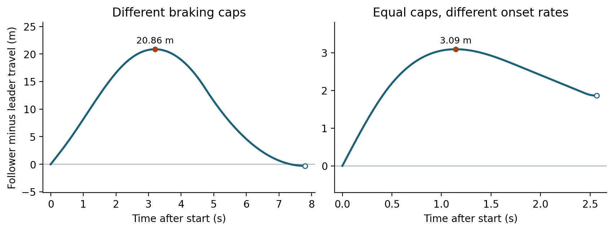

# When final stopping distances miss the largest closure during braking

Vedant Thaker  
Independent Researcher, Jeffersonville, Indiana, USA  
vedant.thaker1602@gmail.com

Computational methods report · November 24, 2026

### Abstract

Comparing two stopping positions can miss the moment when the follower gained the most ground on the leader. For a straight-line model with coasting delay, a linear buildup of deceleration and a constant braking cap, there is a simple case in which final positions suffice. If the follower's braking cap and onset rate are both no greater than the leader's, their relative travel attains its maximum at the start or the end. All 1,296 grid cases satisfying this condition agreed with the complete-trajectory calculation. Ordering only the caps left 29 discrepancies larger than 1 mm among the 648 cases with faster follower onset. Across the full grid, the endpoint calculation understated necessary model clearance by more than 1 m in 236 of 2,916 cases. The largest discrepancy was 20.865 m. A separate retrospective test on measured I-80 trajectories found that endpoint travel understated the sampled peak by over 1 m for 7 of 138 selected approaches to a common near-stop. Five remained above 1 m after median filtering. These observations concern relative motion during congestion; the braking parameters remain uncalibrated.

## A comparison of four distances

A follower may initially close on a slower leader and then shed speed more quickly. Even if the follower eventually stops farther back, the vehicles can have occupied the same planned position earlier. Koopman, Osyk and Weast describe this intermediate-overlap problem and derive a special case for Responsibility-Sensitive Safety (RSS) [1]. The RSS framework defines safe distances together with response rules and assumptions about both vehicles [2]. The experiment here compares calculations on two prescribed motions. It measures the discrepancy introduced by checking just their endpoints.

Let xF(t) and xL(t) denote travel from the two starting positions. With an initial bumper gap g, their remaining gap is g − h(t), where h(t) = xF(t) − xL(t). Four quantities help distinguish the questions:

- **Signed final closure** is SF − SL, where S denotes total stopping distance. It can be negative.
- **Ramp-aware endpoint clearance** is E = max(0, SF − SL).
- **Complete-trajectory clearance** is D = max h(t) over the motion, including h(0) = 0. An initial gap equal to D permits contact at the maximum. The model does not continue the motion as a physical impact.
- **Instantaneous endpoint clearance** is I = max(0, vF τ + vF²/(2bF) − vL²/(2bL)). This additional approximation replaces onset ramps with immediate full deceleration after the follower's coasting delay.

A positive D − E measures the cost of considering only the stopping positions, while holding the model fixed. D − I can have either sign because it also changes both braking profiles. Neither endpoint formula implements the complete RSS policy.

## Motion during onset and at standstill

For initial speed v ≥ 0, nonnegative delay τ, positive cap b and positive onset rate j, a vehicle coasts until τ. While moving, its deceleration magnitude is min(b, j max(0, t − τ)). The leader starts braking at time zero. This ramp-and-cap law specializes the jerk-limited profile in *Vision Zero*, §2.2, to zero initial acceleration [3]. Other work combines jerk limits with a learned driving policy [4]. Here each trajectory is fixed before the comparison.

For elapsed ramp time u, speed is v − ju²/2 and displacement from time zero is v(τ + u) − ju³/6. The ramp lasts r = min(b/j, √(2v/j)) and ends with speed w = max(0, v − jr²/2). Stopping distance is S = vτ + vr − jr³/6 + w²/(2b). Speed remains zero at standstill and acceleration resets there. This idealized release makes a jerk bound applicable to onset only. The model omits steering, road grade, changes in friction, acceleration during response and sensor error.

The program merges the delay ends, ramp ends and stop times of the two vehicles. Relative velocity is at most quadratic between successive boundaries. The program evaluates relative displacement at all boundaries and all interior real roots of relative velocity. After both stops the relative displacement is constant.

## A sufficient condition for an endpoint check

Suppose bF ≤ bL and jF ≤ jL, with nonnegative follower delay and zero leader delay. During the interval when both vehicles are moving, the follower's deceleration magnitude never exceeds the leader's. Consequently the derivative of vF − vL is nonnegative, and h(t) is convex on that interval. Its largest value there occurs at an endpoint.

If the leader stops first, the follower's remaining motion makes h nondecreasing up to its own stop. The largest closure is therefore either h(0) or the final value. If the follower stops first, its velocity relative to the still-moving leader is nonpositive at that instant. Because relative velocity was nondecreasing until then, h has been nonincreasing throughout the joint motion. Leader travel after the follower stops can only reduce h further. The same conclusion holds at simultaneous stops or with a stationary vehicle. Thus D = E under the two orderings. The condition is sufficient. Some pairs violating it also give D = E.

## Factorial test and two witnesses

The deterministic grid crosses three follower speeds (10, 20, 30 m/s), four leader-to-follower speed ratios (0.5, 0.75, 1, 1.25), three braking caps for each vehicle (3, 6, 9 m/s²), three onset rates for each vehicle (5, 10, 20 m/s³), and three follower delays (0, 0.2, 0.5 s). The design gives each combination one observation. Table 1 partitions all 2,916 observations by the two orderings. The 1 mm and 1 m thresholds distinguish numerically small discrepancies from the larger gaps used in the mismatch experiment.

| Follower cap vs. leader | Follower onset rate vs. leader | Cases | D − E > 1 mm | D − E > 1 m | Largest D − E (m) |
|---|---|---:|---:|---:|---:|
| ≤ | ≤ | 1,296 | 0 | 0 | 0.000 |
| ≤ | > | 648 | 29 | 1 | 1.230 |
| > | ≤ | 648 | 279 | 156 | 20.865 |
| > | > | 324 | 159 | 79 | 14.942 |
| All | All | 2,916 | 467 | 236 | 20.865 |

Table 1. Shortfall of the ramp-aware endpoint check. Both inequalities compare magnitudes. A larger onset rate means a faster buildup of deceleration.

In case 2367 the follower starts at 30 m/s, coasts for 0.5 s and reaches a braking cap of 9 m/s². The leader starts at 22.5 m/s and reaches a cap of 3 m/s². Both onset rates are 5 m/s³. Closure peaks at 20.865 m when the speeds coincide at 3.2 s. The follower stops at 4.733 s and the leader at 7.8 s, by which time signed closure is negative and E is zero.

Case 1437 isolates what cap ordering alone misses. Both vehicles have a 9 m/s² cap and start braking immediately, from 20 and 15 m/s respectively. The follower builds deceleration at 20 m/s³ and the leader at 5 m/s³. At 1.144 s the follower has gained 3.091 m. The final gain is only 1.861 m. Both witnesses use grid parameters and appear in the archived scenario table.

The instantaneous endpoint shortcut understated D by more than 1 m in 1,087 cases and overstated it by more than 1 m in 715. Its largest shortfall was 26.257 m. Removing the two ramps changes the stopping distances as well as the interior motion, so the direction of its error varies across cases.

## Sensitivity to the parameter bounds

The preceding comparison holds both trajectories fixed. A second experiment gives the clearance estimator uncertain parameters. Nominal follower speed is uniform between 10 and 30 m/s; the leader speed multiplier is uniform between 0.5 and 1.25. Caps, onset magnitudes and follower delay are drawn independently within the ranges bounded by the grid extremes. Both speeds remain known. Each of the following regimes contains 5,000 draws from the distribution specified in the code, using Python seed 241107.

Within the assigned bounds, the two actual caps and onset rates independently vary by factors between 0.8 and 1.2. The follower delay receives an offset between −0.15 and +0.15 s and is clipped at zero. The conservative corner uses the smallest follower cap and onset rate, largest leader cap and onset rate, and largest follower delay. To see the ordering through standstill, integrate each commanded deceleration up to time t and clamp the remaining speed at zero. The corner increases the follower's speed at each time or leaves it equal, and decreases the leader's speed or leaves it equal. Integrating once more bounds closure at every time under the stipulated interval assumptions.

The nominal and corner estimators each receive the same 1 m margin. Inside the intervals, actual required clearance exceeded the nominal allocation in 1,621 draws and the corner allocation in zero. The corner requested 14.65 m more clearance on average. The second regime deliberately moves outside the original intervals. Follower cap and onset multipliers lie between 0.6 and 0.8, its extra delay between 0.15 and 0.30 s, and leader cap and onset multipliers between 1.2 and 1.4. Actual required clearance then exceeded the two allocations in 4,858 and 4,843 draws respectively. These counts describe the stipulated distributions. Road measurements would be needed to choose bounds for a particular operating domain.

## Measured closing motion before a common near-stop

The same comparison can be made without fitting any brake parameters. In the Federal Highway Administration's NGSIM I-80 trajectories [5], longitudinal position refers to the front of a vehicle. Let g(t) be the leader's longitudinal position minus its length and the follower's longitudinal position. On a chosen observation window the additional sampled closure missed by the endpoints equals min(g at start, g at end) − min(g over the window). A positive value means the sampled pair came closer at an intermediate time than either endpoint suggests. The closest approach can occur between video samples, and trajectory reconstruction itself introduces measurement error [6].

This retrospective check uses the first 9,000 frames of the April 13, 2005 I-80 4 p.m. recording, with observations 0.1 s apart. A candidate window has 61 consecutive samples of a passenger-car follower and leader that identify each other in the same lane and have positive bumper clearance throughout. Both cars must begin at or above 1 m/s and remain at or below 0.5 m/s for the last 11 samples. The interval spans five seconds to the first sample of the required low-speed block and one further second to the primary endpoint. Each follower contributes its earliest qualifying window. The rule was chosen for this comparison after the synthetic results were known. It does not select on the size of the endpoint discrepancy.

| Gap calculation | Endpoint | Followers with excess > 1 m | Maximum excess (m) |
|---|---|---:|---:|
| Recorded positions | End of common low-speed block | 7 / 138 | 3.851 |
| Five-sample median gap | End of common low-speed block | 5 / 138 | 3.183 |
| Recorded positions | Start of common low-speed block | 7 / 138 | 3.851 |

Table 2. Measured intermediate closing displacement above the two endpoints. The centered median uses only samples in each window; its window shrinks at the two edges. The median excess in the primary analysis was zero. All five above threshold after smoothing were among the original seven.

These vehicles were approaching a near-stop in ordinary traffic. The last observation need not be a final stopping position, and video trajectories do not measure brake actuation. The positive-gap selection excludes overlapping records. These films therefore test whether intermediate closing motion can be missed in observed windows. They cannot establish the model's uncertainty bounds, the prevalence of unsafe gaps or collision risk.

## Reproduction and interpretation

The original program evaluates polynomial roots. A separate checker integrates piecewise segments and splits each phase interval at any zero of relative acceleration. Relative velocity is monotone within each resulting interval, so a sign-changing velocity root can be found by bisection. This checker reproduced all 2,916 factorial clearances and all 30,000 nominal, actual and corner clearances to within 8.6 × 10⁻¹⁴ m. All decisions at the 1 m margin agreed. Both implementations use the same motion assumptions. Numerical agreement tests those implementations and supplies no empirical calibration of cap, onset or delay.

The complete original program was also rerun on Linux. Four of its six CSVs matched the archived files byte for byte, including the factorial sweep. The largest numeric differences in the mismatch and witness-trajectory CSVs were 2.85 × 10⁻¹⁴ m and 7.11 × 10⁻¹⁵ m, respectively. The historical dense-time and acceleration-integration checks remain in the supplement. Their maximum discrepancies against the trajectory calculation were 2.89 × 10⁻⁸ m over 200 sampled profiles and 1.13 × 10⁻⁵ m over 40 further pairs.

## Data and code availability

The companion study directory contains the source program, six original CSVs and summary in `study/archived-results.zip`, the separate checker, the figure-generation script, and release and source hashes. Run `python study/check_clearance.py` after extracting the package. The archived computation is identified by its source commit and a SHA-256 manifest in `study/source-hashes.json`. Full regeneration commands and the two execution environments are documented in `study/README.md`. The observational supplement in `study/observed/` identifies the 30 input queries, selection rules, aggregate results and original data provider [5].

## Author and disclosures

Vedant Thaker is the sole author. He reports conducting the original literature discovery, experiment design, implementation and result analysis. The November 11 draft records OpenAI Codex assistance with manuscript prose and Clever Humanizer editing of selected narrative sections. It records use of SciSpace and OATD for literature discovery and author selection of sources. For this edition, OpenAI Codex assisted with formulating and checking the ordering argument, implementing the bisection comparison, rerunning the archived benchmark, producing the two-case figure, designing and executing the observational check, and revising the text.

This research received no specific grant from any funding agency in the public, commercial, or not-for-profit sectors. The author declares no competing interests.

## References

[1] P. Koopman, B. Osyk and J. Weast. Autonomous vehicles meet the physical world: RSS, variability, uncertainty, and proving safety (expanded version). Expanded SafeComp manuscript, 2019, Appendix A. <https://arxiv.org/abs/1911.01207>

[2] S. Shalev-Shwartz, S. Shammah and A. Shashua. On a formal model of safe and scalable self-driving cars. arXiv:1708.06374, version 6, 2018. <https://arxiv.org/abs/1708.06374v6>

[3] S. Shalev-Shwartz, S. Shammah and A. Shashua. Vision Zero: Can roadway accidents be eliminated without compromising traffic throughput? Mobileye technical report, 2018, §2.2. <https://static.mobileye.com/website/corporate/rss/vision_zero_with_map.pdf>

[4] X. He, W. Huang and C. Lv. Toward trustworthy decision-making for autonomous vehicles: A robust reinforcement learning approach with safety guarantees. Engineering 33, 77–89 (2024). <https://doi.org/10.1016/j.eng.2023.10.005>

[5] U.S. Department of Transportation, Federal Highway Administration. Next Generation Simulation (NGSIM) Vehicle Trajectories and Supporting Data (2016), I-80 recording, Emeryville, California, April 13, 2005. <https://doi.org/10.21949/1504477>

[6] M. Montanino and V. Punzo. Making NGSIM data usable for studies on traffic flow theory: Multistep method for vehicle trajectory reconstruction. Transportation Research Record 2390, 99–111 (2013). <https://doi.org/10.3141/2390-11>
